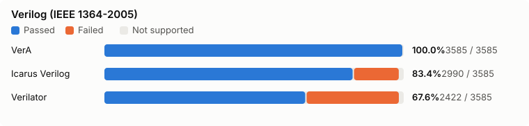
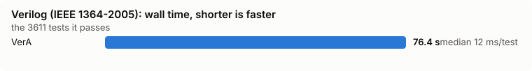
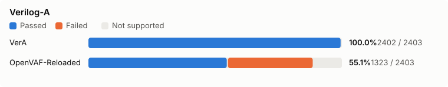
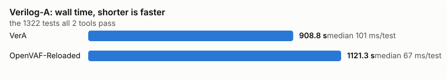
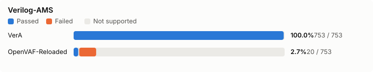
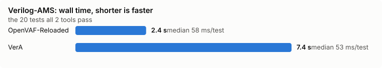
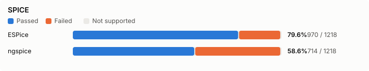
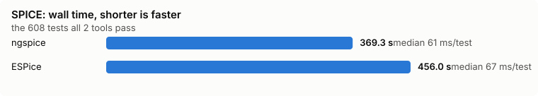

# VAMS Conformance Suite

A conformance and torture suite for Verilog-AMS and its three sublanguages:
Verilog-A (Annex C), IEEE 1364-2005 Verilog, and the SPICE compatibility of
Annex E. It holds hand-written tests that cite the clause they check, pins
larger upstream suites as git submodules, and runs any tool against both with
one harness, `conform` (stdlib Python, 3.11 or newer), which can also keep
every tool's full output as a dump to benchmark against.

The harness knows no tool. A tool is a config file of shell commands, so
VerA, OpenVAF-Reloaded, Icarus Verilog, Verilator and ngspice run the same
tests and are judged by the same rules.

## Quick start

```sh
git clone --recurse-submodules --shallow-submodules https://github.com/OpenFAT/VAMS-Conformance-Suite
cd VAMS-Conformance-Suite
nix develop                       # conform, sprack, openvaf-r, vacask, ngspice, xyce, iverilog, verilator
conform -t tools/iverilog.conf tests/verilog external/ivtest.manifest
conform -t tools/openvaf.conf  tests/verilog-a external/va-models.manifest
```

Without Nix, run `python3 -m harness` from the repository root in place of
`conform`, with the tools on `PATH`.

Every non-passing test prints one line, then a summary:

```
FAIL  verilog-a/ch05_analog_behavior/slew_rate.va: compile exited 65
XPASS verilog/09_behavioral_modeling/case_default.v: expected to fail, passed

2215 tests: 955 passed, 0 compile-only, 1063 failed, 197 skipped, 0 xfail, 0 xpass
```

`conform` exits 1 on any FAIL or XPASS. `-o results.tsv` writes every
verdict with its wall time in milliseconds; `-x tools/<tool>.xfail` turns
known failures into XFAIL, so a CI gate fails only when something changes.
Output and the results file are in test-name order, whatever `-j` is (default
min(4, CPUs)). Each stage has a timeout (`-T`, default 120 s) and a memory cap
(`-M`, in MiB or with a K/M/G suffix, default 4096; `0` for none): it runs
in a systemd user scope with `MemoryMax`, no swap and `OOMPolicy=kill`, so
the kernel kills the stage's whole process tree past the cap, or, without a
systemd user session, the harness samples the process group's resident set
every 100 ms and kills it past the cap. Either way only touched memory
counts, not address space reserved and never used (Zig, LLVM and openvaf-r
reserve far more than they touch, so an rlimit would fail them). A stage
past either limit is killed and fails its test ("compile exceeded 4096 MiB
resident"), never a skip, a pass or a crash of the harness. `-d DIR` keeps every test's full output (Dumps, below).
`python3 -m unittest discover -s harness -t .` feeds the harness scripted
fake tools and checks every verdict, the memory cap and the dump format
(`nix flake check` runs it, with `tools/rawcheck.py --selftest`).

## Layout

| Path | Contents |
|---|---|
| `tests/verilog-a/` | Analog-only tests: the Annex C subset. A Verilog-A compiler must handle all of them. |
| `tests/verilog-ams/` | Tests needing the full language: digital and mixed-signal constructs, VPI. |
| `tests/verilog/` | IEEE 1364-2005 tests by clause (`03_lexical_conventions` ... `A_formal_syntax`, `pli`). |
| `tests/spice/` | Annex E: SPICE primitives, model cards and netlists seen from Verilog-AMS. |
| `tests/netlist/` | SPICE decks by analysis (`op`, `dc`, `tran`, `ac`, `noise`, `pss`, `hb`, ...), each with a `.expected.json` oracle. |
| `tests/include/` | `check.vh`, the `CHECK` assertion macros, and `erfc.vh`. |
| `external/` | Upstream suites as submodules, one `<suite>.manifest` each, and `manifests.py`, which writes them. |
| `harness/` | `conform.py` (the harness, `python3 -m harness`), `dump.py` (dumps and their manifest) and their test. |
| `tools/` | One `<tool>.conf` per tool, adapters, and `<tool>.xfail` baselines. |

Chapter directories follow the Verilog-AMS LRM 2023 (`ch05_analog_behavior`,
`annex_a_syntax`, ...). A test is named after the behavior it checks; a test
of a prohibition ends in `_rejected`.

The `tests/` tree was imported from VerA's fixtures and split by language: a
source that uses anything Annex C excludes from Verilog-A (digital behavior,
`wreal`, `discrete`, `===`, x/z literals, ...) is Verilog-AMS. `tests/netlist/`
was imported from ESPice's fixtures. Both are Apache-2.0.

## Writing a test

A test is a `.va`, `.vams`, `.v` or `.c` file with at least one `//!` line, or
a `.v` with a `<stem>.expected.txt` beside it.

```verilog
// §4.5.7: absdelay(x, td) is x delayed by td, even when td is shorter than a step.
//! lrm 4.5.7
//! bias V(n) = 0
//! wave V(p) = 0, 1, 2, 3
//! time 0, 1n, 2n, 3n
//! analysis tran
`include "check.vh"
module absdelay_short(p, n);
  inout p, n; electrical p, n;
  analog begin
    `CHECK("output(t) == input(t - td)", absdelay(V(p, n), 0.5n) - max($abstime * 1e9 - 0.5, 0.0), 0.0, 1e-12);
    I(p, n) <+ absdelay(V(p, n), 0.5n) * 1.0e-3;
  end
endmodule
```

Two kinds of directive:

- **`//!` lines describe the test.** The tool reads the testbench ones
  (`bias`, `param`, `temp`, `analysis`, `time`, `wave`, `sweep`, `solve`,
  `noise`, `acdyn`, `spice`, ...: the vocabulary of VerA's `--run`) and drives
  the model with them. The harness reads only the verdict ones below.
- **`//@` lines say how to invoke the tool.** The harness exports them as
  environment variables and never interprets them further.

| Line | Read by | Meaning |
|---|---|---|
| `//! lrm 4.5.7`, `//! inherited IEEE 1364-2005 3.8` | nobody | the clause, or `clause:sentence`, the test checks |
| `//! reject <note>` | harness | the tool must refuse the source with a diagnostic (exit 1–125, not a crash or timeout). The note names the expected error, often as VerA's code; the harness does not match it. |
| `//! reject-run <note>` | harness | compiles, and the run must fail |
| `//! exit N` | harness | the run's exit status, 0–125 |
| `//! exit any` | harness | the run may exit with any status 0–125, for a clause that leaves it open (a crash, timeout or exit ≥ 126 still fails); the output checks below still apply |
| `//! checks N` | harness | exactly N `ok=` lines |
| `//! stdout TEXT` | harness | stdout contains TEXT |
| `//! diagnostic` | harness | stdout or stderr has a line that is not blank and holds no `//! stdout` TEXT: a message the tool printed, for a clause that requires one in no set words or stream (IEEE 1364 17.2.9's "an error message is issued") |
| `//! expect stdout GOLD` | harness | stdout equals GOLD (beside the test) instead of `<stem>.expected.txt`; a GOLD that is not there fails the test |
| `//! expect vcd OUT == GOLD` | harness | the VCD the run writes equals GOLD up to what IEEE 1364 18.2 leaves the writer: identifier codes (compared as the names they stand for), the order of `$scope`/`$var` lines and of the changes within one time or section, `1 ns` vs `1ns`, the case of `x`/`z`/`b`/`r`, an event's value, an integer's or time's range, and `$date`, `$version` and `$comment` text; a repeated `$scope`, an empty section or a time with no change counts for nothing. Values, times, sections, the scope tree, var types, sizes and declared ranges must match |
| `//! neighbour FILE` | nobody | the legal twin of a `_rejected` test |
| `//@ files A.v B.v` | tool | more sources (exported absolute as `CONFORM_FILES`) |
| `//@ libmap X.map`, `//@ liblist LIB`, `//@ std 1364-2001` | tool | IEEE 1364 clause 13 configuration and the `begin_keywords` set |
| `//@ protect-keys K.json` | tool | the key file that decrypts an IEEE 1364 clause 28 envelope |
| `//@ negative-timing` | tool | IEEE 1364 15.5.4's invocation option that enables negative `$setuphold` and `$recrem` limits (exported as `CONFORM_NEGATIVE_TIMING=1`); it takes no argument |

### The verdict

1. A test with only metadata (`lrm`, `reject`, ...) is an accept or reject
   test: the compile stage decides it.
2. Any other `//!` line, a `CHECK` macro, or an `.expected.txt` makes it a run
   test. The run must exit 0 (or `//! exit N`, or 0–125 under `//! exit any`), and then:
   - stdout must equal `<stem>.expected.txt` byte for byte;
   - stderr must contain `<stem>.expected.stderr.txt` (stderr also carries the
     tool's own diagnostics, so containment, not equality);
   - no line may say `ok=0`, and a test that uses `CHECK` must print at least
     one `ok=`: a check that never ran is a failure.

`check.vh`'s macros print `NAME got=X want=Y ok=1|0` with `$strobe`, so a
self-checking test needs nothing but a tool that runs `$strobe`.

## Tool configs

A config maps `stage.language` to a shell command; `#` starts a comment.
`version` is a command that prints the tool's exact version, for a dump.

```
compile.verilog = iverilog -g2005 -o "$CONFORM_WORK/sim.vvp" "$CONFORM_SRC" $CONFORM_FILES
run.verilog     = vvp -n "$CONFORM_WORK/sim.vvp"
```

- **Stages:** `compile` then `run`. A tool may define either or both. With
  `compile` only, a run test that compiles counts as *compile-only*, and a
  `reject-run` test is skipped. With `run` only, the run does both; for an
  accept test (compiling is enough) it gets `CONFORM_COMPILE_ONLY=1` and may
  stop after compiling.
- **Languages:** the directory under `tests/` (`verilog-a`, `verilog-ams`,
  `verilog`, `spice`), `vpi` for a `.c` test, `netlist` for a `.sp` deck
  wherever it is filed, or a manifest row's first
  column (`netlist` for SPICE decks). `stage.*` is a fallback. A language with
  no command is skipped.
- **Exit 77** from a stage means the tool cannot express this test (an adapter
  without transient support, say): SKIP, not FAIL.
- Each test runs in its own scratch directory, `CONFORM_WORK`. Files the test
  names that sit beside it are linked in, so a test that reads `x.hex` finds
  it and a test that writes `x.log` writes into scratch, not the tree.

| Variable | Value |
|---|---|
| `CONFORM_SRC` | the test source, absolute |
| `CONFORM_DIR`, `CONFORM_STEM` | its directory; its name without extension |
| `CONFORM_REL`, `CONFORM_LANG` | its path from the suite root; its language |
| `CONFORM_WORK` | the scratch directory, also the working directory |
| `CONFORM_INCLUDE` | `tests/include` (for a manifest test, the suite's root) |
| `CONFORM_TOOLDIR` | the config's directory, for adapters beside it |
| `CONFORM_FILES`, `CONFORM_LIBMAP`, `CONFORM_LIBLIST`, `CONFORM_STD`, `CONFORM_PROTECT_KEYS`, `CONFORM_NEGATIVE_TIMING` | from `//@` lines |
| `CONFORM_COMPILE_ONLY` | `1` when only compiling is judged (see Stages) |
| `CONFORM_<KEY>` | from a manifest row's `KEY=VALUE` columns (a row sets these, not `//@` lines: `STD`, `INCDIR`, `DIRS` the directories its runner makes in the cwd, `DEFINES`, `SHIM` an include directory under `external/`). The harness reads `FILTER`, `RTOL`, `ATOL` and `DIFF=OUT:GOLD` (the file the run writes must equal GOLD, compared as `//! expect vcd`) |

| Config | Languages | Notes |
|---|---|---|
| `vera.conf` | all four | `vera --run`; run under VerA's own `nix develop`. Defaults to the sibling checkout `../Zig/VerA/zig-out/bin/vera` for now; `VERA=` overrides |
| `openvaf.conf` | `verilog-a`, `spice` | `openvaf-r` to OSDI, then `ngspice-osdi.py` runs the library in ngspice at the test's DC operating point and prints its `ok=` lines; transient, AC and noise testbenches SKIP |
| `iverilog.conf` | `verilog` | `iverilog` + `vvp` |
| `verilator.conf` | `verilog` | `verilator --binary --timing` |
| `ngspice.conf` | `netlist` | `tests/netlist/` through `rawcheck.py`, and the external decks |
| `ngspice-converged.conf` | `netlist` | as `ngspice.conf` at `reltol=1e-9`, `vntol=1e-15`, `abstol=1e-18`: a golden that passes `ngspice.conf` and fails here was recorded at a tolerance looser than its `rtol`. Decks without an `.expected.json` SKIP |
| `espice.conf` | `netlist` | as `ngspice.conf`; `ESPICE=` overrides the executable |
| `xyce.conf` | `netlist` | `Xyce -r`, every deck translated to Xyce's dialect first |
| `vacask.conf` | `netlist` | `vacask`, every deck translated to VACASK's dialect first; its per-analysis raw files joined |

### SPICE decks

A `.sp` deck in `tests/netlist/` is a test when a `<stem>.expected.json`
oracle sits beside it. The oracle lists the plots the simulator's binary raw
file must hold, each column's values and its `rtol`/`atol`, how rows match
(`exact`, `selected_rows`, interpolated `samples`, `unordered`), `.meas`
results, or `status: error` for a deck that must be refused. The tool's run
stage calls `tools/rawcheck.py` with its simulator command; rawcheck runs it in
the deck's directory and prints one `ok=` line per check:

```
run.netlist = python3 "$CONFORM_TOOLDIR/rawcheck.py" 'ngspice --batch ${RAW:+-r "$RAW"} "$DECK"'
```

rawcheck judges every check kind tests/test_correctness.zig does, on what the
tool writes; a kind it does not know is an `ok=0` line, "unported check kind
X": unsupported fails, never skips. An optional second command reruns the
deck without RAW when its oracle reads stdout (`.meas` lines, `.four`
tables), which ngspice prints only without `-r`.
A deck in another dialect names it in its
oracle (`tokenizer: hspice`), passed on as `TOKENIZER`. A config that sets
`SPRACK_TO` (the dialect its tool reads; `SPRACK_READS`, others it reads as
they are) has every other deck translated first, with everything it
includes, by SpiceRack: `sprack project --from <d> --to <target> --out DIR
DECK` (`ngspice`, `espice`, `xyce`, `vacask`). sprack's refusal, a construct the
target cannot say, is the run's failure: it passes a `status: error` oracle
and fails any other. The flake builds `sprack` at the SPRack commit
`flake.lock` pins.

## Manifests

An upstream suite keeps its own files and its own idea of the right answer.
`external/manifests.py` reads that from each submodule and writes
`external/<suite>.manifest`, which `conform` takes like a directory:

```
#root iverilog/ivtest
verilog	ok	ivltests/always3.1.1A.v	gold/always3.1.1A.gold	STD=1364-2005	FILTER=grep -v '^VCD info'
```

Columns, tab-separated: language, want, source, gold (`-` for none), then
`KEY=VALUE` pairs exported as `CONFORM_KEY`. Paths are relative to `#root`.

| Want | Passes when |
|---|---|
| `ok` | compile and run exit 0; stdout equals the gold, if one is given |
| `passed` | as `ok`, and a line of stdout reads `PASSED` (ivtest's convention) |
| `compile` | the compile stage succeeds |
| `reject`, `reject-run` | as the `//!` directives |

Two keys change the gold comparison: `FILTER` is a shell command both stdout
and the gold pass through first (upstream's own filter, so a tool's banner
does not count), and `RTOL`/`ATOL` compare the numbers in them within
`atol + rtol·max(|a|, |b|)`. `STDERR` is text the run's stderr must contain (a reject-run's diagnostic). A test name is `<manifest>/<source>`, which is
also how an xfail file lists it.

Where the governing LRM (IEEE 1364-2005, VAMS-2023) decides a test
differently from its upstream suite, `external/expectations.tsv` overrides
the row's want and gold and names the clause, written into the row as
`LRM=`. Most are upstream tests of a construct the LRM forbids, now `reject`
(issue #1); the gold files it adds live in `external/gold/`. A name there that
no manifest has stops `manifests.py`.

| Manifest | Upstream | Selected | Rule |
|---|---|---:|---|
| `ivtest` | Icarus Verilog `ivtest` | 1854 | `regress-vlg.list` ("any simulator that supports standard Verilog") and the vvp JSON tests, without Icarus-only options or non-1364 system tasks |
| `sv-tests` | chipsalliance/sv-tests | 131 | tests whose text is IEEE 1364-2005 |
| `ispras-1364` | ISP RAS `ieee-1364-2005` | 327 | the standard's own examples; POSITIVE compile, NEGATIVE reject, VARYING left out |
| `openvaf` | OpenVAF-Reloaded | 65 | diagnostic tests (an `error` in the expected log means reject) and the integration-test models |
| `gnucap-modelgen` | gnucap-modelgen-verilog | 195 | model tests; `.error.` names reject |
| `va-models` | dwarning/VA-Models | 92 | every compact model must compile |
| `ngspice` | ngspice `tests/` | 108 | `make check` decks against their `.out` |

`external/Xyce_Regression` is pinned but has no manifest yet: its oracle is
`xyce_verify.pl`'s per-column tolerances over `.prn` files.

## Results

Every Monday `.github/workflows/conformance.yml` fetches each tool at its
latest version (`tools/ci.sh`: VerA and ESPice at their default branch,
OpenVAF-Reloaded at its newest release, the rest at nixpkgs-unstable), runs it
over every test and manifest, and redraws these charts with `tools/report.py`.
Each language gets two charts. Conformance is the tests a tool passes over
every test in the language: a test it cannot express counts against it, as
"not supported". Speed is the wall time `conform` measured per test (compile
and run), summed over the tests every charted tool passes, so each tool is
timed on the same work. Each tool runs on its own GitHub-hosted runner of the
same class, with min(4, CPUs) tests in parallel; treat differences under
about 20% as noise.

<!-- conformance:start -->
Measured 2026-11-15 by `.github/workflows/conformance.yml`, each tool at its latest version (`tools/ci.sh` says which).














<details><summary>The numbers</summary>

| Language | Tool | Version | Passed | Failed | Not supported | Conformance | Time on common tests |
|---|---|---|---:|---:|---:|---:|---:|
| Verilog (IEEE 1364-2005) | VerA | vera 0.23.0 | 3611 | 0 | 0 | 100.0% | 76.4 s (3611) |
| Verilog-A | VerA | vera 0.23.0 | 2452 | 0 | 0 | 100.0% | 1354.1 s (2452) |
| Verilog-AMS | VerA | vera 0.23.0 | 755 | 0 | 0 | 100.0% | 1122.6 s (755) |
| SPICE | ESPice | espice espice 0.20.0 (VerA 0.23.0 0bc0092b345e7b87977e7240660ce6767ea78367; backends: cpu) | 1016 | 238 | 2 | 80.9% | 456.0 s (608) |
| SPICE | ngspice | ** ngspice-45 : Circuit level simulation program | 740 | 514 | 2 | 58.9% | 369.3 s (608) |

</details>
<!-- conformance:end -->

## Dumps

`conform -d DIR/<tool>` keeps everything a tool did on every test it ran, so
any tool can be benchmarked against any other without rerunning them.
`.github/workflows/dumps.yml` builds a full set every Monday and on every
push to `main` (`tools/ci.sh <tool> results/dumps`, one job per tool) and
publishes it as the release `dumps-<run number>`: the tarball
`dumps-<n>.tar.gz`, its `dumps-<n>.manifest.json` and `SHA256SUMS`. Dumps are
never committed.

```sh
gh release download dumps-42 -R Scouren/Conformance-Suite   # or the latest: gh release list
sha256sum -c SHA256SUMS
tar -xzf dumps-42.tar.gz                                    # dumps/<tool>/..., dumps/manifest.json
```

One tool's directory:

| File | Contents |
|---|---|
| `tool.json` | `tool`, `version` (the config's `version` command's output), `source` (where `ci.sh` got it: flake ref and revision, nixpkgs revision, release URL; and the sprack revision), `config` and `config_sha256`, `date`, `records` and `records_sha256`, `format` (1) |
| `records.jsonl` | one JSON object per test the tool ran, in test-name order: `test`, `verdict` (as `-o`), `detail`, `ms` (wall time), `stages` (each stage: `stage`, `exit`, `ms`, `stdout`, `stderr`), and for a SPICE deck `simulator` (each run `rawcheck.py` made: `run` = `translate`, `sim`, `again` or `measure`, its `command`, `exit`, `ms`, `stdout`, `stderr`) and `raw`, `raw_sha256` |
| `raw/<test>.raw` | the deck's waveforms |

`exit` is the exit status, or -1 for a signal, -2 for the timeout, -3 for the
memory cap. A stream over 4 MiB keeps its first 4 MiB and records its full
size as `stdout_bytes` or `stderr_bytes`. A test with no command for its
language has no record.

The waveforms are one binary SPICE raw file per deck, rewritten canonically:
only the header lines a reader needs (`Title`, `Plotname`, `Flags`, `No.
Variables`, `No. Points`, `Variables`, `Binary`; no `Date` or command line),
every value a little-endian IEEE double (complex: real, imaginary), every plot
the tool wrote in its order. The raw format is what ngspice, ESPice, Xyce and
VACASK already write, so nothing is lost or rounded in conversion, unlike CSV
or JSON numbers; it reads with Python's `struct` alone (`parse_raw` in
`tools/rawcheck.py`, 40 lines), and two runs that computed the same numbers
write the same bytes, so `raw_sha256` compares results across tools and
versions. A raw file that does not parse is kept as the tool wrote it.

`manifest.json` covers the set:

| Key | Contents |
|---|---|
| `format`, `suite`, `suite_commit`, `date` | the format version (1), this repository, the commit the set ran at, when |
| `tools` | per tool: its `tool.json` and `available: true`; or `available: false` and `why` (HSPICE is always such a slot: licensed, no runner; a tool whose job failed is another) |
| `decks` | per test name: the sha256 of its source (`tests/<name>`, or a manifest row's source under its `#root`) |
| `dumps` | per tool, per test: `record_sha256` (its `records.jsonl` line) and, for a deck, `raw_sha256` |

`python3 -m harness.dump manifest DIR [TOOL=WHY]...` writes it over a
directory of tool dumps.

## License

The tests imported from VerA and ESPice are Apache-2.0. Each submodule keeps its own
license; nothing of theirs is copied into this tree.
